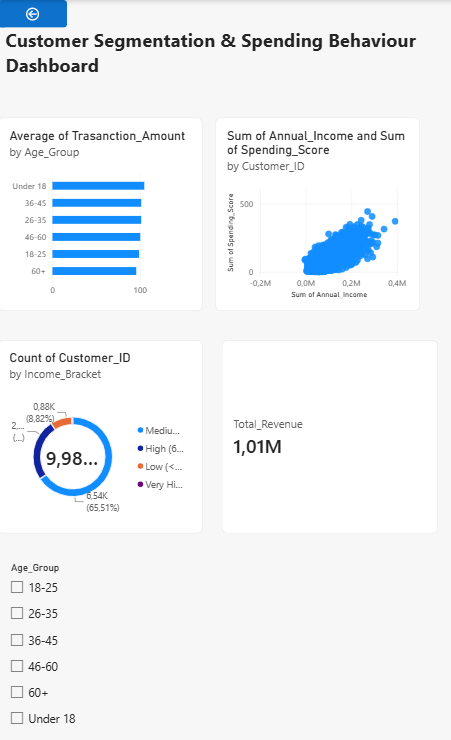
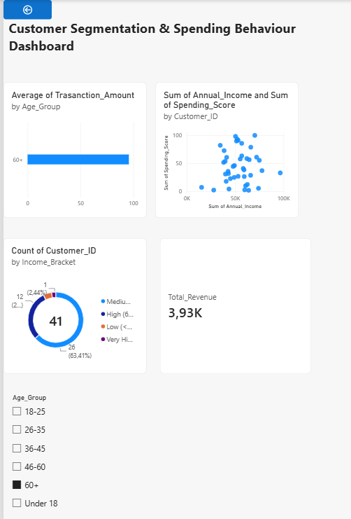

# Analysis of Customer Spending Behaviour

An end-to-end data analytics project that cleans, analyses and visualises a messy customer transaction dataset to identify meaningful spending patterns and behaviours that can support informed business decision-making.

**Pipeline:** Excel (data cleaning) → MySQL (data analysis) → Power BI (data visualisation)

---

## Background

Understanding customer behaviour is central to how businesses make decisions about marketing, retention and product strategy. In practice, the data available for this kind of analysis is rarely clean. It usually contains duplicate records, missing values, inconsistent formatting and outliers that need to be identified and resolved before any reliable analysis can take place.

This project focuses on a customer transactions dataset containing numerical data on customer spending patterns, incomes, ages and purchase behaviours. The aim is to identify meaningful patterns that could support informed business decision-making.

## Aim and Objectives

**Aim:** To identify meaningful spending patterns and behaviours that can support informed business decision-making.

**Objectives:**
- Clean and prepare the customer transaction dataset
- Explore spending patterns based on age, income and purchase frequency
- Identify customer groups with similar spending behaviours
- Generate meaningful insights that can support business decision-making

## Dataset

- **Source:** Kaggle
- **Size:** about 10,000 rows and 6 columns
- **Raw file:** `data/unclean_customer_data.csv`
- **Cleaned file:** `data/clean_customer_data.csv`

## Data Quality Issues Identified

| Issue | Details |
|---|---|
| Duplicate rows | 200 rows were identical across every column |
| Missing values | 247 missing Age values and 242 missing Transaction Amount values |
| Outliers | 6 unrealistic Age values (0 to 3 years old) |
| Invalid values | 218 negative Transaction Amount values, with no refund or return field to explain them |
| Unreliable ID values | Repeated Customer_ID values often had different Age and Income attached |

After cleaning, the dataset was reduced to **9,989 rows** with no missing values or duplicate records.

---

## Methodology

### Phase 1: Data Cleaning (Excel)

I followed the standard data cleaning procedure:

1. **Inspected the data** to understand each column and spot problems (blanks, odd values, inconsistent formatting).
2. **Removed exact duplicate rows** using Excel's Remove Duplicates feature (200 rows removed).
3. **Treated Customer_ID as unreliable.** The same ID often had different Age and Income values, so each row was treated as an individual transaction record rather than a unique customer.
4. **Handled missing values.** Missing Age and Transaction Amount values were filled with the column **median**, chosen over the mean so that outliers do not distort the result.
5. **Investigated and removed invalid data:** unrealistic Age values (0 to 3) and negative Transaction Amount entries.
6. **Created derived columns,** `Age_Group` and `Income_Bracket`, to support later segmentation.

### Phase 2: Analysis (SQL / MySQL Workbench)

1. Created a database and **imported the cleaned dataset** into MySQL.
2. **Converted** `Annual_Income` and `Transaction_Amount` from formatted text into numeric fields using SQL string functions.
3. **Wrote queries** to group and segment customers by age group, income bracket, spending score and purchase behaviour, calculating average spending and customer counts for each segment.

All queries are in the `sql/` folder.

### Phase 3: Visualisation (Power BI)

1. Connected Power BI to the cleaned dataset.
2. Built an **interactive dashboard** to explore customer segments and spending patterns, including:
   - Average transaction amount by age group
   - Income vs spending score scatter plot
   - Customer count by income bracket
   - Total revenue
   - An age group slicer to filter the whole dashboard

---

## Results

### Spending by Age Group

| Age group | Average spending | Number of customers |
|---|---|---|
| Under 18 | 104.98 | 448 |
| 18-25 | 99.06 | 1,380 |
| 26-35 | 101.47 | 3,686 |
| 36-45 | 101.47 | 3,179 |
| 46-60 | 100.36 | 1,255 |
| Over 60 | 95.80 | 41 |

Average spending is fairly consistent across the age groups, clustering between about 99 and 101.5 for the 18-25 to 46-60 groups. Under 18 recorded the highest average (104.98) and the 60+ group the lowest (95.80). Customers are heavily concentrated in the 26-35 and 36-45 groups, which together account for 6,865 of the 9,989 customers, compared with only 41 in the 60+ group. Age alone is unlikely to be a strong determinant of spending behaviour in this dataset.

### Spending Score by Income Bracket

| Income bracket | Average spending score |
|---|---|
| Low (under 30k) | 50.31 |
| Medium (30k-60k) | 50.68 |
| High (60k-90k) | 50.55 |
| Very high (90k+) | 47.51 |

Scores are consistent across the low, medium and high income brackets (50.31 to 50.68). The very high income bracket is the only clear outlier, with a lower average of 47.51. Higher income does not correspond to higher spending scores in this dataset, so income alone is unlikely to be a strong predictor of spending behaviour.

---

## Dashboard

**Overall Customer Segmentation Dashboard:**



**Filtered to Under 18** (448 customers, R47.03k revenue):


**Filtered to 60+** (41 customers, R3.93k revenue):



---

## Conclusion and Recommendations

Spending behaviour does not vary meaningfully by age or income, so neither factor reliably predicts customer value in this dataset.

- **Avoid segmenting customers by age or income alone.** Doing so would not effectively distinguish higher-value customers from lower-value ones.
- **Explore other variables,** such as purchase frequency, as potentially stronger indicators of spending behaviour.
- **Collect more balanced data.** The 60+ segment is very small (41 customers), so future data collection should aim for more balanced representation across age groups before drawing conclusions about that group.

Overall, this project demonstrates the ability to clean, process and analyse data through a complete pipeline, while also recognising when the data does not support strong demographic-based conclusions.

---

## Repository Structure

```
├── README.md
├── data/        Raw (unclean) and cleaned datasets
├── sql/         SQL queries used for analysis
├── powerbi/     Power BI dashboard file
├── images/      Dashboard screenshots
└── report/      Full project report (PDF)
```

## Tech Stack

- **Excel:** data exploration and cleaning
- **MySQL:** data transformation and segmentation queries
- **Power BI:** interactive dashboard and visualisation

## Author

**Ritlhavile Leol Makondo**
Email: ritlhavilemakondo@gmail.com
LinkedIn: [www.linkedin.com/in/ritlhavile-makondo](https://www.linkedin.com/in/ritlhavile-makon)
